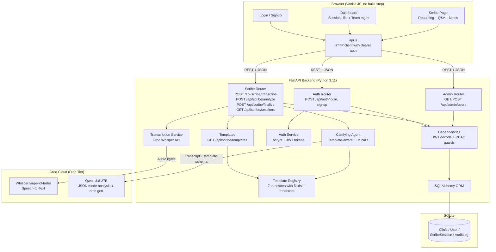
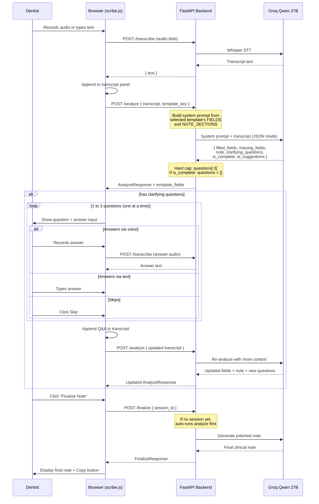
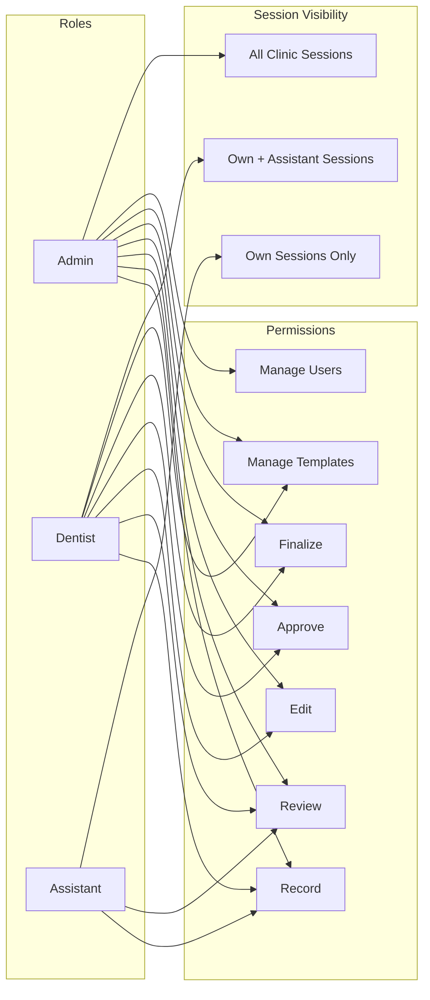
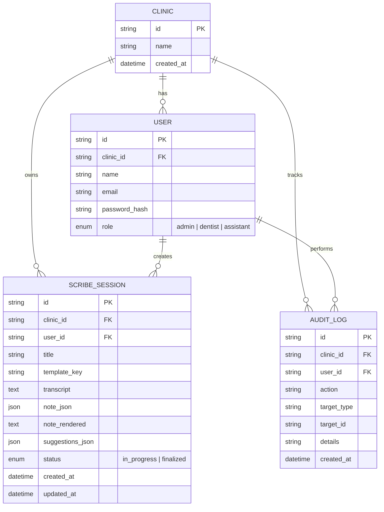

# Milya Scribe Plus

AI-powered dental clinical documentation with intelligent clarifying questions and multi-template support.

**Live Demo**: [milya-scribe-plus.onrender.com](https://milya-scribe-plus.onrender.com)

---

## Features

- **Voice + Text input**: Record dentist-patient conversations or type them in. Whisper with dental vocabulary bias handles transcription.
- **7 Summary Templates**: Comprehensive Exam, Emergency Exam, Recall Exam, SOAP Comprehensive, SOAP Emergency, SOAP Summarize, and Summarize. Each template defines its own fields, note sections, and rendering.
- **Smart Clarifying Agent**: The LLM analyzes the transcript against the selected template, generates a best-effort note, identifies missing fields, and asks up to 3 follow-up questions one at a time.
- **AI Clinical Suggestions**: Differential diagnoses and recommended next steps grounded in the transcript (dentist/admin only). Each prefixed with confidence level: "Likely:", "Possible:", "Consider:".
- **Structured Notes**: Outputs a formatted clinical note ready to paste into any dental PMS.
- **Multi-Tenancy**: Each clinic's data is fully isolated via `clinic_id` on every table.
- **Role-Based Access Control**: Three roles (Admin, Dentist, Assistant) with distinct dashboards, permissions, and session visibility.
- **Session Auto-naming**: LLM generates concise 3-5 word session titles during analysis.

---

## System Architecture



---

## Clarifying Agent Flow

This is the core loop. The agent makes two types of LLM calls:

1. **Analyze**: extract fields, generate best-effort note, ask clarifying questions
2. **Finalize**: generate polished clinical note from the full transcript



---

## Template System

Each template is a Python module in `backend/app/templates/` with three exports:

| Export | Type | Purpose |
|--------|------|---------|
| `TEMPLATE_NAME` | `str` | Display name (e.g., "Comprehensive Examination") |
| `FIELDS` | `dict` | Field definitions with labels and descriptions for the LLM |
| `NOTE_SECTIONS` | `list[tuple]` | Ordered (label, key) pairs defining the rendered note structure |
| `render_note(note_dict)` | `function` | Formats the LLM's JSON output into a readable clinical note |

The agent service builds its system prompt dynamically from the template's `FIELDS` and `NOTE_SECTIONS`, so adding a new template requires zero changes to the LLM integration code.

Available templates:

| Template | Key | Use Case |
|----------|-----|----------|
| Comprehensive Examination | `comprehensive_exam` | Full new patient exam |
| Emergency Examination | `emergency_exam` | Urgent/walk-in visits |
| Recall Examination | `recall_exam` | Periodic checkups |
| SOAP Comprehensive | `soap_comprehensive` | SOAP format, full exam |
| SOAP Emergency | `soap_emergency` | SOAP format, emergency |
| SOAP Summarize | `soap_summarize` | SOAP format, brief summary |
| Summarize | `summarize` | Quick free-text summary |

---

## Role-Based Access Control



---

## Data Model



---

## API Endpoints

| Method | Path | Auth | Description |
|--------|------|------|-------------|
| POST | `/api/auth/signup` | No | Create account + clinic |
| POST | `/api/auth/login` | No | Get JWT token |
| GET | `/api/auth/me` | Yes | Current user info |
| GET | `/api/scribe/templates` | Yes | List available templates |
| POST | `/api/scribe/transcribe` | record | Upload audio, get text |
| POST | `/api/scribe/analyze` | record | Analyze transcript against template |
| POST | `/api/scribe/finalize` | finalize | Generate polished final note |
| GET | `/api/scribe/sessions` | record | List sessions (role-filtered) |
| GET | `/api/scribe/sessions/:id` | record | Get session detail |
| GET | `/api/admin/users` | manage_users | List clinic team |
| POST | `/api/admin/users` | manage_users | Add team member |

---

## Tech Stack

| Layer | Technology |
|-------|-----------|
| Backend | Python 3.11, FastAPI, SQLAlchemy, Pydantic v2, SQLite |
| Frontend | Vanilla HTML/CSS/JS (no build step, no framework) |
| STT | Groq Whisper large-v3-turbo (dental vocabulary bias) |
| LLM | Groq Qwen 3.8-27B (JSON mode, temperature 0.1) |
| Auth | bcrypt password hashing, Bearer JWT tokens |
| Hosting | Render (free tier, auto-deploy from GitHub) |

---

## Project Structure

```
milya-scribe-plus/
  backend/
    app/
      main.py              # FastAPI app, CORS, static file serving
      config.py            # Pydantic settings (GROQ_API_KEY, models, etc.)
      database.py          # SQLAlchemy engine + session factory
      models.py            # ORM: Clinic, User, ScribeSession, AuditLog
      dependencies.py      # JWT auth + RBAC permission decorators
      routers/
        auth.py            # Signup (creates clinic), login (returns JWT)
        scribe.py          # Transcribe, analyze, finalize, list sessions
        admin.py           # Team management endpoints
      schemas/
        auth.py            # Pydantic request/response for auth
        scribe.py          # Pydantic request/response for scribe
      services/
        auth.py            # Password hashing, JWT encode/decode
        transcription.py   # Groq Whisper API with dental vocab prompt
        agent.py           # Template-aware LLM calls (analyze + finalize)
      templates/
        __init__.py              # Template registry + get_template()
        comprehensive_exam.py    # 10-field comprehensive exam
        emergency_exam.py        # Emergency visit template
        recall_exam.py           # Recall/periodic checkup
        soap_comprehensive.py    # SOAP format, comprehensive
        soap_emergency.py        # SOAP format, emergency
        soap_summarize.py        # SOAP format, summary
        summarize.py             # Quick summary template
    requirements.txt
  frontend/
    css/style.css          # Full responsive stylesheet
    js/
      api.js               # HTTP client with Bearer auth + 401 handling
      auth.js              # Login/signup form logic
      scribe.js            # Recording, analysis loop, Q&A, finalize
    login.html
    signup.html
    dashboard.html         # Role-specific cards + session list
    scribe.html            # Main scribe workspace
  render.yaml              # Render deployment blueprint
  .python-version          # Pin Python 3.11.12 for Render
```

---

## Local Development

```bash
cd backend
python -m venv venv
venv\Scripts\activate      # Windows
pip install -r requirements.txt
```

Create `backend/.env`:
```
GROQ_API_KEY=your_key_here
```

Run:
```bash
cd backend
uvicorn app.main:app --reload
```

Open http://localhost:8000

---

## Deploy to Render

1. Push to GitHub
2. On [Render](https://render.com), click **New+ > Blueprint**
3. Connect the repo (auto-reads `render.yaml`)
4. Set `GROQ_API_KEY` environment variable
5. Deploy

---

## Key Design Decisions

- **Template-driven prompts**: The LLM system prompt is built dynamically from the selected template's fields and sections. Adding a new template (e.g., periodontal exam) means adding one Python file with no changes to the agent or router code.
- **One-at-a-time Q&A**: Questions are shown sequentially instead of all at once, creating a natural conversation flow that mirrors how dentists interview patients.
- **Best-effort notes**: The note is always generated, even with incomplete information. The clarifying loop makes it progressively better, but the note is usable from the first analysis.
- **Max 3 questions per round**: Hard-capped in the backend (`questions[:3]`), not just in the prompt. After answering or skipping, the agent re-analyzes with updated context and may ask new questions.
- **AI suggestions as decision support**: Differential diagnoses and next steps are explicitly labeled with confidence levels ("Likely:", "Possible:", "Consider:"), never presented as definitive diagnoses.
- **Backend-enforced consistency**: `is_complete=true` forces `questions=[]` server-side, regardless of what the LLM returns. The frontend also tracks a `finalized` flag to prevent questions from appearing after finalize.
- **SQLite for simplicity**: No external database to configure. Data persists locally; on Render free tier it resets on deploy (acceptable for a demo).
- **No build step**: The frontend is plain HTML/CSS/JS served as static files by FastAPI. No npm, no webpack, no React. This keeps deployment simple and the codebase easy to understand.
