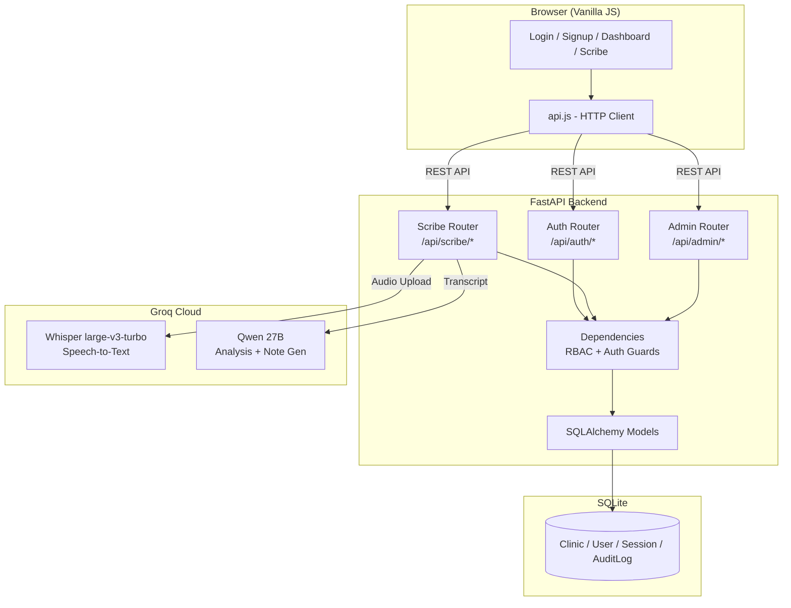
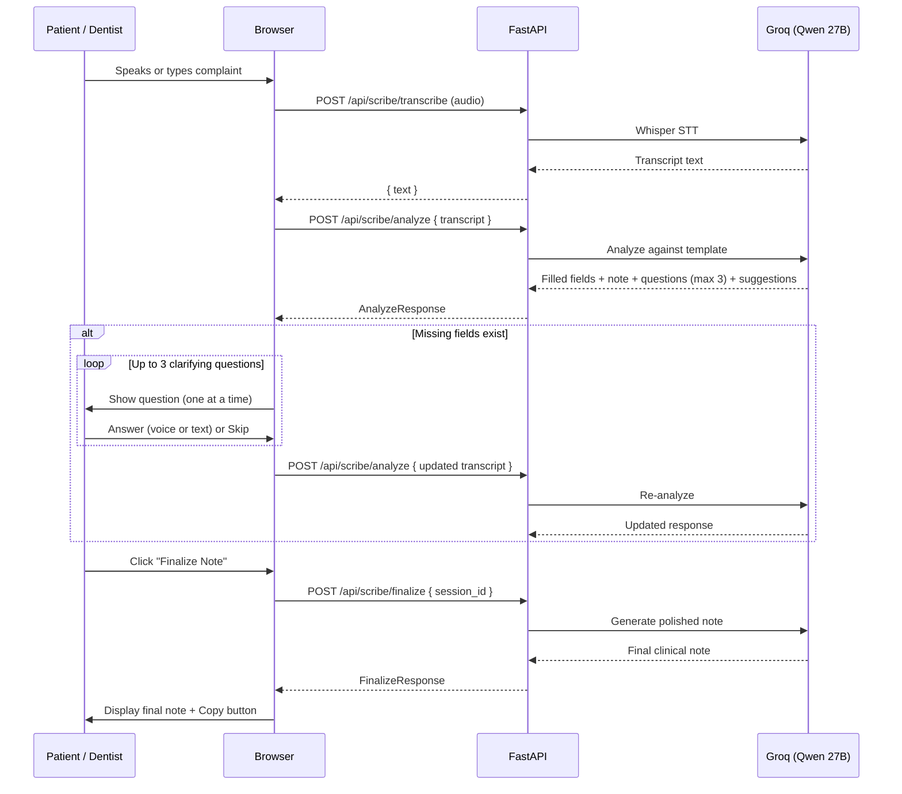
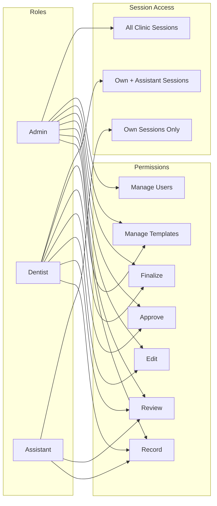
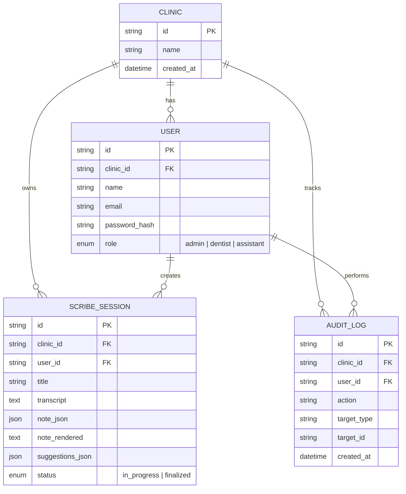

# Milya Scribe Plus

AI-powered dental clinical documentation with intelligent clarifying questions.

**Live Demo**: [milya-scribe-plus.onrender.com](https://milya-scribe-plus.onrender.com)

---

## Features

- **Voice + Text input**: Record patient conversations or type them in. Whisper with dental vocabulary bias handles transcription.
- **Smart Clarifying Agent**: The LLM analyzes the transcript against a Comprehensive Examination template, generates a note AND identifies missing fields with up to 3 follow-up questions asked one at a time.
- **AI Clinical Suggestions**: Differential diagnoses and recommended next steps grounded in the transcript (dentist/admin only).
- **Structured Notes**: Outputs a formatted clinical note ready to paste into any dental PMS.
- **Multi-Tenancy**: Each clinic's data is fully isolated via `clinic_id` on every table.
- **Role-Based Access Control**: Three roles (Admin, Dentist, Assistant) with distinct dashboards, permissions, and session visibility.
- **Session Auto-naming**: LLM generates concise 3-5 word session titles during analysis.

---

## System Architecture



---

## Clarifying Agent Flow



---

## Role-Based Access Control



---

## Data Model



---

## Tech Stack

| Layer | Technology |
|-------|-----------|
| Backend | Python 3.11, FastAPI, SQLAlchemy, SQLite |
| Frontend | Vanilla HTML/CSS/JS (no build step) |
| STT | Groq Whisper large-v3-turbo |
| LLM | Groq Qwen 27B (JSON mode) |
| Auth | bcrypt password hashing, Bearer token sessions |
| Hosting | Render (free tier) |

---

## Project Structure

```
milya-scribe-plus/
  backend/
    app/
      main.py              # FastAPI app, static file serving
      config.py            # Pydantic settings from env
      database.py          # SQLAlchemy engine + session
      models.py            # ORM: Clinic, User, ScribeSession, AuditLog
      dependencies.py      # Auth guards, RBAC permission checks
      routers/
        auth.py            # /api/auth/signup, /api/auth/login
        scribe.py          # /api/scribe/transcribe, analyze, finalize
        admin.py           # /api/admin/users, audit
      schemas/
        auth.py            # Request/response models for auth
        scribe.py          # Request/response models for scribe
      services/
        auth.py            # Password hashing, token generation
        transcription.py   # Whisper API with dental vocab bias
        agent.py           # Clarifying agent + final note LLM calls
      templates/
        comprehensive_exam.py  # Field definitions + note renderer
    requirements.txt
  frontend/
    css/style.css
    js/
      api.js               # HTTP client with auth headers
      auth.js              # Login/signup form logic
      scribe.js            # Recording, analysis loop, Q&A, finalize
    login.html
    signup.html
    dashboard.html
    scribe.html
  render.yaml              # Render deployment blueprint
  .python-version          # Pin Python 3.11.12
```

---

## Local Development

```bash
cd backend
python -m venv venv
venv\Scripts\activate      # Windows
pip install -r requirements.txt
```

Create `backend/.env`:
```
GROQ_API_KEY=your_key_here
```

Run:
```bash
cd backend
uvicorn app.main:app --reload
```

Open http://localhost:8000

---

## Deploy to Render

1. Push to GitHub
2. On [Render](https://render.com), click **New+ > Blueprint**
3. Connect the repo (auto-reads `render.yaml`)
4. Set `GROQ_API_KEY` environment variable
5. Deploy

---

## Key Design Decisions

- **One-at-a-time Q&A**: Questions are shown sequentially instead of all at once, creating a natural conversation flow that mirrors how dentists interview patients.
- **Best-effort notes**: The note is always generated, even with incomplete information. The clarifying loop makes it progressively better but the note is usable from the first analysis.
- **Max 3 questions per round**: Keeps the interaction focused. After answering or skipping, the agent re-analyzes and may ask new questions based on updated context.
- **AI suggestions as decision support**: Differential diagnoses and next steps are explicitly labeled as suggestions ("Likely:", "Possible:", "Consider:"), never presented as definitive diagnoses.
- **SQLite for simplicity**: No external database to configure. Data persists locally; on Render free tier it resets on deploy (acceptable for a demo).
